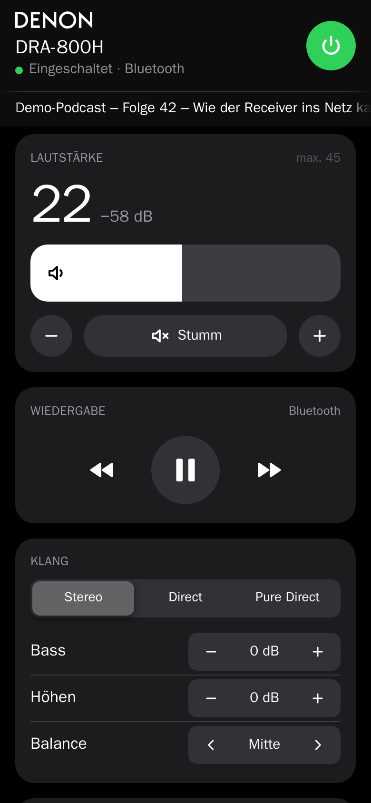
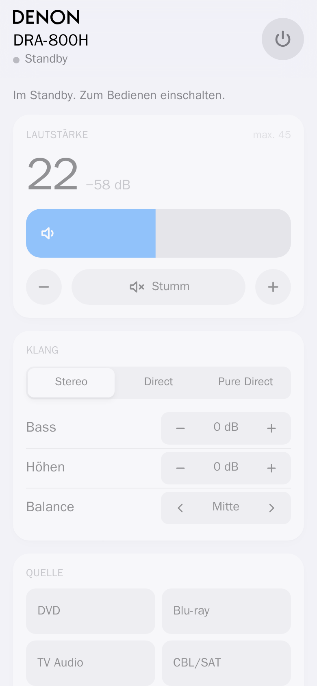
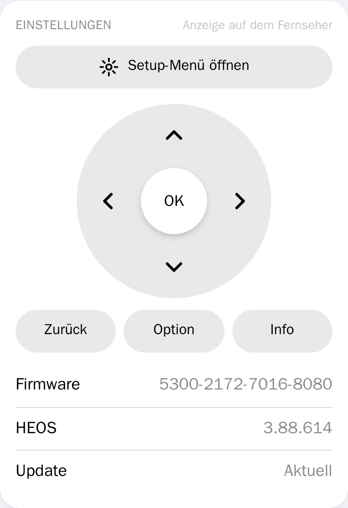
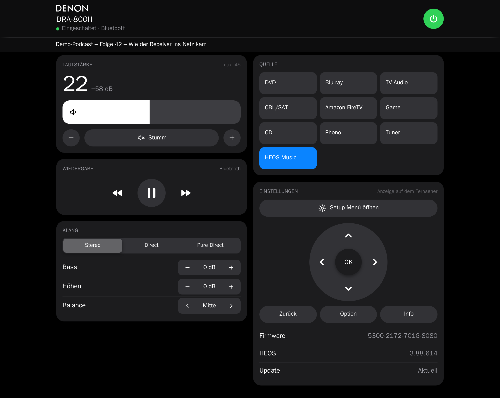
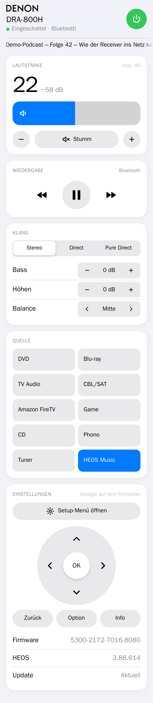
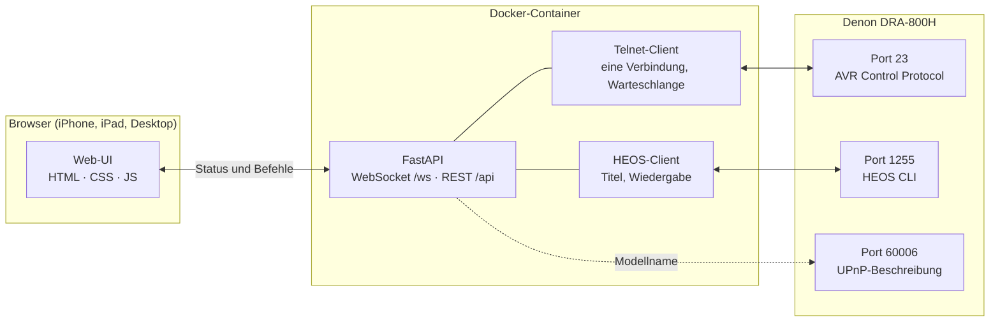

# Denon Web-UI

Eine eigene Web-Oberfläche für Denon-Netzwerkreceiver, gebaut für den **Denon DRA-800H**. Sie läuft im Browser auf iPhone, iPad und Desktop, ohne App und ohne Installation, und ist im Stil von Apple gestaltet.

Der Receiver wird über seine offiziellen Netzwerkschnittstellen gesteuert (Telnet und HEOS), es ist also kein Eingriff in das Gerät nötig. Das Backend läuft als Docker-Container auf dem Mac oder einem Raspberry Pi.

<p align="center">
  
  &nbsp;
  
  &nbsp;
  
</p>

<p align="center">
  
</p>

<details>
<summary>Ganze Seite auf dem iPhone (helles Design)</summary>
<p align="center"></p>
</details>

> Die Screenshots zeigen Demo-Daten. Auf Apple-Geräten erscheint die Systemschrift SF Pro.

---

## Inhalt

- [Funktionen](#funktionen)
- [So funktioniert es](#so-funktioniert-es)
- [Installation](#installation)
- [Konfiguration](#konfiguration)
- [Bedienung](#bedienung)
- [Schnittstelle (API)](#schnittstelle-api)
- [Entwicklung](#entwicklung)
- [Erkenntnisse zum DRA-800H](#erkenntnisse-zum-dra-800h)
- [Grenzen](#grenzen)
- [Hinweise](#hinweise)

## Funktionen

| Bereich | Was geht |
|---|---|
| **Kopf** | Denon-Logo und Modellname (liest das Backend selbst vom Gerät), Status wie „Eingeschaltet · Bluetooth“, großer Ein/Aus-Knopf |
| **Laufband** | Interpret und Titel laufen wie ein Nachrichtenticker durch; bei Pause hält das Band an |
| **Lautstärke** | Große Anzeige mit dB-Wert, breiter Slider wie im iOS-Kontrollzentrum, − / + (gedrückt halten wiederholt), Stumm-Knopf (rot, wenn aktiv) |
| **Obergrenze** | Die Web-UI stellt nie lauter als `MAX_VOLUME` (Standard 45); Antippen des Sliders allein ändert nichts |
| **Wiedergabe** | Zurückspulen, Play/Pause, Vorspulen für das, was über HEOS läuft, z. B. vom iPhone per Bluetooth |
| **Klang** | Stereo / Direct / Pure Direct, Bass und Höhen (±6 dB), Balance (L12 bis R12) |
| **Quelle** | Alle genutzten Eingänge mit den Namen, die am Gerät vergeben sind |
| **Einstellungen** | Setup-Menü öffnen und mit Steuerkreuz, OK, Zurück, Option und Info bedienen (Bild auf dem Fernseher), Firmware- und HEOS-Version, Update-Status |
| **Live** | Alles, was am Gerät, mit der Fernbedienung oder in der HEOS-App passiert, erscheint sofort in der Web-UI |
| **Design** | Hell- und Dunkelmodus automatisch, berücksichtigt „Bewegung reduzieren“, „Transparenz reduzieren“ und „Kontrast erhöhen“ |

## So funktioniert es



- **Eine einzige Telnet-Verbindung** für alle Browser. Viele Denon-Modelle erlauben nur eine, deshalb hängen die Browser am Backend und nicht direkt am Receiver.
- **Warteschlange mit Abstand:** Befehle gehen mit mindestens 100 ms Pause raus. Ein schnell gezogener Slider erzeugt keinen Stau, weil gleichartige Befehle sich ersetzen, solange sie noch nicht gesendet sind.
- **Live-Status:** Der Receiver meldet jede Änderung von selbst. Das Backend wertet jede Zeile aus und schickt den neuen Zustand per WebSocket an alle Browser.
- **Sofortige Reaktion:** Die Web-UI zeigt eine Änderung sofort an und gleicht sie danach mit der Rückmeldung des Receivers ab. Lehnt er ab, springt die Anzeige zurück.
- **Selbstheilend:** Bricht eine Verbindung ab, baut das Backend sie mit wachsender Wartezeit neu auf. Ein Heartbeat erkennt tote Verbindungen.

## Installation

Voraussetzungen: Docker (auf dem Mac z. B. [OrbStack](https://orbstack.dev) oder Docker Desktop) und ein Receiver mit fester IP im Heimnetz.

```bash
git clone https://github.com/georgheiner/denon-webui.git
cd denon-webui
cp .env.example .env      # IP des Receivers eintragen
docker compose up -d --build
```

Danach ist die Web-UI unter `http://<IP des Rechners>:8000` erreichbar, auf dem Rechner selbst unter http://localhost:8000.

### Mac mit OrbStack

Damit Container Geräte im Heimnetz erreichen, braucht OrbStack die macOS-Freigabe **Systemeinstellungen → Datenschutz & Sicherheit → Lokales Netzwerk**. Ohne sie erreichen Container zwar das Internet, aber nicht den Receiver.

### Raspberry Pi

Das Image läuft auf `arm64` (Raspberry Pi 4/5 mit 64-Bit-System) genauso wie auf `amd64`. Auf dem Pi wie oben klonen, `.env` anlegen und starten. `restart: unless-stopped` sorgt dafür, dass der Container nach einem Neustart wieder hochkommt.

## Konfiguration

Alle Einstellungen stehen in der `.env` (Vorlage: [`.env.example`](.env.example)).

| Variable | Standard | Bedeutung |
|---|---|---|
| `DENON_HOST` | – (Pflicht) | IP-Adresse des Receivers |
| `DENON_PORT` | `23` | Telnet-Port |
| `MAX_VOLUME` | `45` | Höchste Lautstärke, die die Web-UI einstellt (Skala 0–98). Das Gerät hat zusätzlich ein eigenes Limit (`MVMAX`), es gilt der kleinere Wert |
| `WEB_PORT` | `8000` | Port, unter dem die Web-UI erreichbar ist |
| `LOG_LEVEL` | `INFO` | `DEBUG` zeigt jeden gesendeten und empfangenen Befehl |

## Bedienung

- **Lautstärke-Slider:** ziehen, nicht tippen. Ein bloßes Antippen ändert nichts, damit ein versehentlicher Tipp ganz rechts nicht plötzlich laut macht. Am Ende gibt der Slider weich nach, statt hart anzuschlagen.
- **Tastatur:** Pfeiltasten ändern die Lautstärke um 0,5, Bild↑/Bild↓ um 5.
- **Standby:** Lautstärke, Klang und Quelle sind ausgegraut, weil der Receiver diese Befehle im Standby ignoriert.
- **Stumm:** Jede Lautstärkeänderung hebt Stumm am Gerät auf. Die Web-UI zeigt das so an, wie der Receiver es meldet.
- **Vor-/Zurückspulen:** Die Tasten schicken „nächster/vorheriger Titel“ an den HEOS-Player. Hörbuch- und Podcast-Apps machen daraus einen Sprung im Titel, Musik-Apps meist einen Titelwechsel.
- **Setup-Menü:** Das Bild erscheint nur auf dem per HDMI angeschlossenen Fernseher. Die Web-UI ersetzt die Fernbedienungstasten.

## Schnittstelle (API)

Die Web-UI nutzt nur den WebSocket. Die REST-Endpunkte sind zum Testen und für eigene Automationen gedacht.

| Endpunkt | Zweck |
|---|---|
| `GET /api/state` | Aktueller Zustand als JSON |
| `POST /api/command` | Befehl senden, z. B. `{"cmd": "volume", "value": 30}` |
| `GET /api/health` | Läuft der Server, ist der Receiver verbunden |
| `WS /ws` | Server → Browser: `{"type": "state", "state": {...}}` bei jeder Änderung; Browser → Server: `{"cmd": ..., "value": ...}` |

**Befehle**

| `cmd` | `value` | Wirkung |
|---|---|---|
| `power` | `true` / `false` | Ein / Standby |
| `mute` | `true` / `false` | Stumm an / aus |
| `volume` | Zahl, 0,5er-Schritte | Lautstärke setzen (auf die Obergrenze begrenzt) |
| `volume_step` | `"up"` / `"down"` | Einen Schritt lauter / leiser |
| `input` | Code aus `inputs`, z. B. `"NET"` | Quelle wählen |
| `sound_mode` | `"STEREO"`, `"DIRECT"`, `"PURE DIRECT"` | Klangmodus |
| `bass`, `treble` | −6 … 6 | Bass / Höhen in dB |
| `balance` | −12 … 12 | Balance, negativ = links |
| `play_state` | `"play"`, `"pause"`, `"stop"` | Wiedergabe über HEOS |
| `next`, `previous` | – | Vor- / Zurückspulen bzw. Titelwechsel |
| `menu` | `"open"`, `"close"`, `"up"`, `"down"`, `"left"`, `"right"`, `"enter"`, `"back"`, `"option"`, `"info"` | Setup-Menü |

Beispiel mit `curl`:

```bash
curl -X POST localhost:8000/api/command -H 'content-type: application/json' -d '{"cmd":"mute","value":true}'
```

## Entwicklung

```text
backend/
  app/protocol.py   Zustandsmodell, Parser für Receiver-Meldungen, Befehle mit Prüfung
  app/client.py     Telnet-Verbindung, Warteschlange, Reconnect, Modellname per UPnP
  app/heos.py       HEOS CLI: Titel, Wiedergabestatus, Steuerung, Update-Prüfung
  app/main.py       FastAPI: WebSocket, REST, Auslieferung des Frontends
  tests/            pytest, u. a. gegen nachgebaute Receiver- und HEOS-Dienste
frontend/
  index.html  styles.css  app.js   ohne Build-Schritt
tools/screenshots.py               Screenshots für diese README
```

Das Frontend wird ins Image kopiert. Nach Änderungen also neu bauen:

```bash
docker compose up -d --build
```

Tests laufen im Container, damit die Python-Version auf dem Rechner keine Rolle spielt:

```bash
docker run --rm -v "$PWD/backend:/src" -w /src python:3.12-slim sh -c "pip install -q -r requirements-dev.txt && python -m pytest -q"
```

### Screenshots erneuern

Bei laufendem Container. Playwright ersetzt dabei den WebSocket durch Demo-Daten, an den Receiver geht kein Befehl.

```bash
docker run --rm --ipc=host -v "$PWD/tools:/work" -v "$PWD/docs/screenshots:/out" mcr.microsoft.com/playwright/python:v1.49.1-noble sh -c "pip install -q --break-system-packages playwright==1.49.1 && python3 /work/screenshots.py http://host.docker.internal:8000 /out"
```

## Erkenntnisse zum DRA-800H

Am Gerät ermittelt (Firmware 5300-2172-7016-8080, HEOS 3.88.614):

- **Offene Ports:** 23 (Telnet), 80, 443, 8080, 10443, 1255 (HEOS), 60006 (UPnP).
- **Lautstärke:** Skala 0–98, `MV10` = 10, `MV455` = 45,5. Das Gerät ist auf `MVMAX 60` begrenzt.
- **Im Standby** werden Mute- und Lautstärkebefehle ohne Rückmeldung ignoriert. Nach `PWON` dauert es etwa 3 s, bis Befehle angenommen werden.
- **Jede Lautstärkeänderung hebt Mute auf.**
- **Balance:** `BL0` (Mitte), `BLL3` (links), `BLR2` (rechts). `PSBAL` und Kanalpegel per `CV` gibt es nicht.
- **Eingangsnamen** per `SSFUN ?`, genutzte Eingänge per `SSSOD ?`.
- **Klangmodi:** `MSSTEREO`, `MSDIRECT`, `MSPURE DIRECT`.
- **Firmware** per `SSINFFRM ?`, Setup-Menü-Status per `MNMEN?`.
- **HEOS:** Ein per Bluetooth verbundenes iPhone erscheint als `mid: "Bluetooth"` mit Titel, Interpret und Album.
- **Die erste Abfrage** nach längerer Ruhe bleibt manchmal unbeantwortet. Das Backend wiederholt sie automatisch.

Andere Denon- und Marantz-Modelle mit demselben Protokoll sollten weitgehend funktionieren, getestet ist nur der DRA-800H.

## Grenzen

- **Setup-Menü:** Das Menübild wird nicht über das Netzwerk übertragen. Wer es im Browser sehen will, bräuchte einen HDMI-Capture-Stick am Backend-Rechner.
- **Lautstärke-Obergrenze:** Sie gilt nur für die Web-UI. Fernbedienung, Drehknopf und HEOS-App können bis zum Gerätelimit gehen.
- **Bluetooth koppeln:** Dafür gibt es keinen eigenen Befehl. Es geht über das Setup-Menü oder die Fernbedienung.
- **Zone 2** und HEOS-Streamingdienste mit Cover sind noch nicht eingebaut.
- **Ohne Zugangsschutz:** Die Web-UI hat keine Anmeldung und ist für das eigene Heimnetz gedacht. Nicht ins Internet freigeben.

## Hinweise

Privates Projekt, nicht mit Denon oder Sound United verbunden. „Denon“ und „HEOS“ sind Marken ihrer Inhaber. Der Denon-Schriftzug stammt von [Wikimedia Commons](https://commons.wikimedia.org/wiki/File:Denon_Logo.svg) (dort als gemeinfrei gekennzeichnet). Die Gestaltungsregeln orientieren sich unter anderem an [emilkowalski/skills – apple-design](https://github.com/emilkowalski/skills/blob/main/skills/apple-design/SKILL.md).
